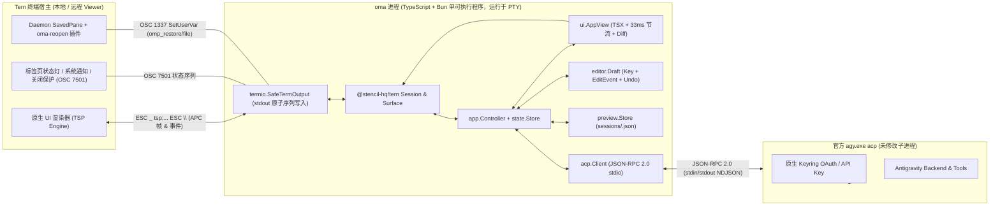
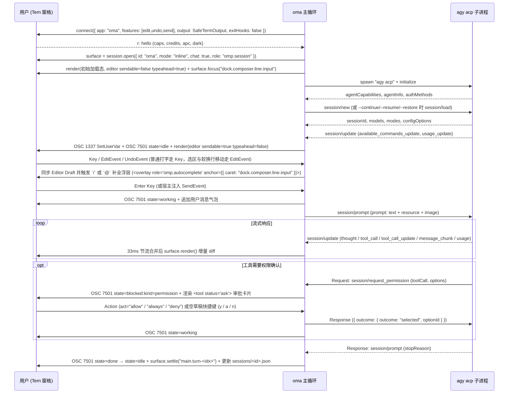

# Oh My Agy (`oma`) 详细设计文档

> **项目路径**：`D:\Projects\oh-my-agy`  
> **启动命令**：`oma`（Windows: `oma.exe`，Linux/macOS: `oma`）  
> **核心架构**：方案三 — 基于 `@stencil-hq/tern` (TypeScript + Bun) 的 TSP 原生前端 + 官方 `agy acp` 后端 + 配套 `oma-reopen` Tern Host 插件  
> **目标环境**：Tern `0.9.29+` / Antigravity CLI `1.5.13+` / Bun `1.4+`（本机已核验：Tern `0.9.29` / `agy 1.5.13` / Bun `1.4.5`） / TypeScript `5.x+`  
> **文档状态**：已完成与 Tern `0.9.29`、`@stencil-hq/tern` 源码及 `agy 1.5.13` ACP 报文的逐项对齐，达到正式实装就绪标准。

---

## 1. 背景、目标与非目标

### 1.1 为什么做 `oma`

在 Tern 中接入 `agy` 时，零配置的内置方案（`tern acp agy`）虽然开箱即用，但受限于 Tern 通用 ACP 客户端的固定实现：

1. **斜杠命令固定**：无法使用习惯的 `/resume`（会被当成普通聊天文本发给模型），只能用 `/sessions`。
2. **会话选择器无预览**：`/sessions` 右侧恒显示 `Nothing to preview`，历史会话多时检索不便。
3. **UI 与交互不可定制**：工具调用卡片折叠策略、思考过程展示、工具自动放行白名单、快捷键与自定义命令无法按个人习惯定制。
4. **不支持纯 SSH 透传**：`tern acp` 依赖窗格直连 Tern daemon（`TERN_PANE_SOCKET`），在无 Tern 服务的普通 SSH 目标机上无法运行。

`oma` 采用与 Tern 官方 `omp` 同源的 **PTY + TSP（Tern Surface Protocol）** 架构，通过后台对接官方 `agy acp` 服务端，实现“完整 Antigravity 能力 + 完全可控的原生 Tern 聊天体验 + 跨平台/纯 SSH 通用”。

### 1.2 核心目标

- **原生级交互体验**：复用 Tern 原生多行编辑器（`features: ['edit', 'undo', 'send']`，支持中文 IME 定位、软换行、选区替换、鼠标点击定位与 `Ctrl+Z` 撤销），复用 Tern 原生渲染组件（`<message>` / `<trace>` / `<tool>` / `<picker>` / `<overlay>` / `<diff>` / `<code>` / `<md>`）。
- **补齐并超越原生体验**：
  - 完整实现 `/resume`（含实时搜索高亮、`This folder` / `All folders` 作用域切换、右侧对话摘要预览）。
  - 光标下方实时弹出 `/` 命令补全与 `@file` 工作区文件补全（支持 `embeddedContext`）。
  - 支持本地剪贴板图片粘贴（通过 TSP Blob + ACP `image` 能力）。
  - 支持模型、思考档位（`thought_level`）与权限模式（`mode`）快捷键/点击切换，以及自定义工具审批策略。
  - 通过 `OSC 7501` 接入 Tern 标签页工作指示灯、后台系统通知、Agents 状态感知与关闭确认保护。
  - 通过配套轻量插件 `plugins/oma-reopen` 实现 Tern daemon 重建后的会话自动续连。
- **跨平台零依赖分发**：单文件编译，支持本地 Windows、远程 Tern Host（Linux/Windows）及无 Tern 的纯 SSH Linux 服务器；离开 Tern 环境自动优雅回退。

### 1.3 非目标与 ToS 合规红线

为严格遵守 Google Antigravity 服务条款并规避账号风控，项目在架构层设立不可逾越的红线：

1. **仅调用未修改的官方 `agy acp` 子进程**：所有认证（本地 Keyring OAuth / 企业登录 / API Key / Vertex AI）与网络通信完全由官方 `agy` 进程完成。
2. **严禁触碰 OAuth 凭证**：`oma` 绝不读取、提取、缓存或转发任何 OAuth Token，不传伪造标识参数（如 `--override_user_agent_name`）。
3. **严禁封装无头自动刷量循环**：后端不采用 `agy -p --input-format stream-json` 驱动无人值守循环，不暴露 HTTP / OpenAI 兼容代理接口；`oma` 严格定位为**单人实时交互式终端前端**。
4. **不尝试在单窗格内热切换非 `agy` Agent**：多 Agent 热切换（Claude/Codex 等）仍由 Tern 原生 `tern acp` 负责，两者互补共存。

---

## 2. 技术栈选型、目录结构与工程配置

### 2.1 技术栈选择：TypeScript + Bun + `@stencil-hq/tern`

参考 Tern 官方原生 Agent `omp` 的实现路线，对比 Go / Rust / TypeScript 方案后最终选定 **TypeScript + Bun**：

| 维度 | TypeScript + Bun (`@stencil-hq/tern`) | Go (`go/tern`) | Rust (`tern-sdk`) |
| --- | --- | --- | --- |
| 与官方 `omp` 一致性 | **最高**：可采用 JSX/TSX 声明式构建 `View`，与官方文档和 `omp` 结构同源 | 结构体命令式组装，嵌套稍繁琐 | Builder 链式调用，Borrow 检查较重 |
| SDK 零依赖与体积 | 官方 `@stencil-hq/tern` 本身 **0 运行时依赖**，API 极清爽 | 仅 `x/term` + `x/sys` | crate 较多 |
| 事件与文本模型 | JS 原生 UTF-16 字符串，与 TSP `cursor` / `anchor` / `edit` 坐标系 **天然一致** | 需反复 `[]uint16` <-> `string` 编解码 | 需自行维护 UTF-16 与 UTF-8 偏移映射 |
| 编译与分发体验 | 本地 Bun `1.4.5` 已就绪；`bun test` 秒级单测；`bun build --compile` 直接输出单文件可执行程序 | 单文件交叉编译极强 | 单文件分发好，但编译速度慢 |
| 异步与 JSON-RPC 处理 | `async`/`await` + JSON 原生对象直接适配动态 `configOptions` 与复杂 ACP Schema | 强类型 struct 处理多变 Schema 较啰嗦 | 同 Go |

> 说明：由于 `@stencil-hq/tern` 随 [stencil-hq/tern-sdk](https://github.com/stencil-hq/tern-sdk) 发布而未推送至公共 npm registry，项目统一将其固定同步至本地 `vendor/tern` 目录（对应仓库 `typescript/` 子目录，记录同步 commit SHA），通过 `file:./vendor/tern` 接入，保证离线开发与 `bun build --compile` 100% 可复现。

### 2.2 项目目录规划

```text
D:\Projects\oh-my-agy\
├── README.md
├── package.json
├── tsconfig.json
├── docs/
│   └── DESIGN.md                  # 本文档
├── vendor/
│   └── tern/                      # @stencil-hq/tern SDK（同步自 stencil-hq/tern-sdk/typescript）
├── src/
│   ├── bin/
│   │   └── oma.ts                 # CLI 入口、参数解析、TSP 探测与原生 agy 回退
│   ├── acp/                       # ACP JSON-RPC 2.0 客户端层
│   │   ├── client.ts              # Bun.spawn 子进程托管、不限行长 NDJSON 读取与请求路由
│   │   ├── protocol.ts            # ACP 请求/响应/通知完整 TypeScript 类型定义
│   │   ├── model.ts               # ACP 双轨模型 ID（基模型 + thought_level <-> 完整模型 ID）映射
│   │   └── path.ts                # Windows /D:/... 路径标准化与对比
│   ├── termio/                    # 终端 I/O 与扩展转义序列层
│   │   ├── output.ts              # SafeTermOutput 原子同步包装器（防止 TSP 与 OSC 交错）
│   │   ├── osc.ts                 # OSC 7501 状态上报 & OSC 1337 SetUserVar & OSC 7
│   │   └── clipboard.ts           # 跨平台剪贴板读取（文本与图片）与复制
│   ├── state/                     # 单一数据源与状态机
│   │   ├── store.ts               # AppState、焦点状态、事件派发与渲染调度通知
│   │   ├── transcript.ts          # Turn、Message、Thought、Tool、Subagent、Plan 模型
│   │   ├── approval.ts            # 权限审批队列与自动放行规则匹配
│   │   └── traffic.ts             # 内存环形缓冲区（供 /log 查看 ACP 与 TSP Error 流量）
│   ├── editor/                    # 原生编辑器草稿引擎
│   │   ├── draft.ts               # 双轨 UTF-16 编辑引擎（Key + EditEvent + Undo 栈）
│   │   ├── history.ts             # 输入历史上下翻页与持久化
│   │   └── trigger.ts             # 光标处 `/` 命令与 `@` 文件补全触发探测
│   ├── commands/                  # 斜杠命令注册表与执行器
│   │   ├── registry.ts            # 内置命令 + ACP 动态命令合并、模糊匹配与高亮
│   │   └── handlers.ts            # /resume /new /model /thought /mode /copy /log /help /quit
│   ├── filesearch/                # `@file` 工作区文件索引器
│   │   └── indexer.ts             # 异步扫描当前 cwd（忽略 .git/node_modules 等）与模糊评分
│   ├── preview/                   # 会话索引与预览摘要存储
│   │   └── store.ts               # 读写本地 sessions/<id>.json（兼作 reopen 锚点文件）
│   ├── swarm/                     # 原生 Swarm Board 蜂群数据源与轻量监控
│   │   └── board.ts               # 解析 swarm.json / members.json / board.jsonl 与 mtime+size 轮询监控
│   ├── ui/                        # 纯函数式 TSX 视图构建层
│   │   ├── AppView.tsx            # 顶层 { main, dock, layer } TSX 视图组合
│   │   ├── TranscriptView.tsx     # 欢迎页、消息、思考块、工具卡、Diff、子 Agent、Plan
│   │   ├── ComposerView.tsx       # 底部 <editor>、附件条、排队消息与 <status> 状态栏
│   │   ├── PickerView.tsx         # /resume /model /thought /mode /log 与 Swarm Board 直挂 layer 的模态 <picker>
│   │   ├── PopupView.tsx          # 光标下方 `/` 与 `@` 补全浮层（<overlay anchor={{ caret }}>）
│   │   └── scheduler.ts           # 33ms 帧合并节流器 + surface.settle / GoneEvent 管理
│   ├── config/                    # 用户配置加载与校验
│   │   └── config.ts              # Bun.TOML.parse 读取 config.toml
│   └── app/                       # 顶层应用编排器
│       ├── controller.ts          # 事件主循环（TSP Input <-> ACP Updates <-> Timer <-> Signal）
│       └── fallback.ts            # 非 Tern 终端参数翻译透传原生 agy 或 --plain 降级
├── test/                          # bun:test 单元测试与脚本化终端集成测试
│   ├── draft.test.ts
│   ├── acp_client.test.ts
│   ├── fallback.test.ts
│   └── ui.test.tsx
├── plugins/
│   └── oma-reopen/                # 配套 Tern Host 插件（重启自动恢复）
│       ├── plugin.toml
│       ├── host.luau
│       └── README.md
└── scripts/
    └── build.ps1                  # bun build --compile 打包与安装到 PATH 脚本
```

### 2.3 工程初始化配置契约

由于 `vendor/tern` 源码采用 ESM `.js` 扩展名相对导入且通过 `exports` 的 `"bun": "./src/index.ts"` 暴露源码入口，项目根目录必须使用以下确定的基础配置：

- `package.json`：
  ```json
  {
    "name": "oh-my-agy",
    "version": "0.1.0",
    "private": true,
    "type": "module",
    "bin": {
      "oma": "./src/bin/oma.ts"
    },
    "scripts": {
      "dev": "bun run src/bin/oma.ts",
      "typecheck": "tsc --noEmit",
      "test": "bun test",
      "build:win": "bun build --compile src/bin/oma.ts --outfile dist/oma.exe",
      "build:linux": "bun build --compile --target=bun-linux-x64 src/bin/oma.ts --outfile dist/oma"
    },
    "dependencies": {
      "@stencil-hq/tern": "file:./vendor/tern"
    },
    "devDependencies": {
      "@types/bun": "latest",
      "typescript": "^5.8.0"
    }
  }
  ```
- `tsconfig.json`：
  ```json
  {
    "compilerOptions": {
      "target": "ESNext",
      "module": "ESNext",
      "moduleResolution": "bundler",
      "jsx": "react-jsx",
      "jsxImportSource": "@stencil-hq/tern",
      "strict": true,
      "noUncheckedIndexedAccess": true,
      "exactOptionalPropertyTypes": false,
      "skipLibCheck": true,
      "noEmit": true,
      "types": ["bun"]
    },
    "include": ["src/**/*.ts", "src/**/*.tsx", "test/**/*.ts", "test/**/*.tsx"]
  }
  ```

---

## 3. 总体架构与数据流

### 3.1 系统分层架构



### 3.2 核心交互时序（启动 → 对话 → 工具审批 → 中断）



---

## 4. 核心子系统详细设计

### 4.1 终端 I/O 与多协议复用（`src/termio`）

#### 关键约束（基于 `@stencil-hq/tern/src/session.ts` 源码核实）

1. `connect()` 从 `options.input`（默认 `process.stdin`）和 `options.output`（默认 `process.stdout`）检查 `.isTTY`、读取 `.columns` 并调用 `input.setRawMode(true)`。
2. **必须显式设置 `exitHooks: false`**：
   - 在 `@stencil-hq/tern/src/session.ts` 中，当传入自定义 `options.output`（`SafeTermOutput`）时，`exitHooks` 默认值为 `false`；
   - 且若开启 `exitHooks: true`，SDK 内部监听 `SIGINT` / `SIGTERM` / `SIGHUP` 后会直接 `session.close()` 并 `process.kill(process.pid, signal)` 终止进程，绕过给 `agy acp` 发送 `session/close` 的优雅清理过程。
   - 因此 `oma` 统一传 `exitHooks: false`，由 `app/controller.ts` 统一注册信号处理器（先关闭 `agy acp` 会话并等待最多 500ms，再执行 `session.close()` 恢复 raw mode、kitty keyboard 与 bracketed paste，最后退出）。
3. 任意 TSP APC 帧与 `OSC 7501` / `OSC 1337` 控制序列必须以单次完整 `.write(chunk)` 提交，且在 `session.close()` 之后禁止再写入任何控制帧。

#### 解决方案

1. 定义 `SafeTermOutput`（实现 `TermOutput` 接口代理 `process.stdout`，透传 `isTTY` 与 `columns`）：通过 `closed` 守卫与整段字符串/字节数组一次性 `.write()`，保证 APC 帧与 OSC 序列原子提交且关闭后静默丢弃悬挂写入。
2. 测试场景可向 `connect()` 注入内存假终端（实现 `TermInput` / `TermOutput`），做到 100% 离线端到端仿真测试。
3. 封装扩展控制序列写入方法（均支持在 `config.toml` 中独立开关）：
   - **工作状态上报（`OSC 7501`，键值对严格以冒号 `:` 分隔，ST 为 `\x1b\\`）**：
     - `setStatusIdle()` → `\x1b]7501;state=idle\x1b\\`（空闲安全态；Tern 的 `confirm_close` 仅在最后状态为 `working` 或 `blocked` 时拦截关闭窗格）
     - `setStatusWorking()` → `\x1b]7501;state=working\x1b\\`
     - `setStatusBlocked(kind)` → `\x1b]7501;state=blocked:kind=<permission|question|auth>\x1b\\`
     - `setStatusDone()` → `\x1b]7501;state=done\x1b\\`（回合完成时触发后台通知与状态变化，随后用户下次输入或延迟切回 `idle`）
     - `setStatusError()` → `\x1b]7501;state=error\x1b\\`
     - `setStatusClear()` → `\x1b]7501;state=clear\x1b\\`（正常退出 `oma` 前发送）
   - **重启恢复锚点（`OSC 1337 SetUserVar`）**：
     - `setReopenAnchor(indexFile)` → 输出 `\x1b]1337;SetUserVar=omp_restore=MQ==\x07` 与 `\x1b]1337;SetUserVar=omp_session_file=<base64(indexFile)>\x07`
     - `clearReopenAnchor()` → 正常退出时输出 `omp_restore=` 与 `omp_session_file=`（空值）清除标记
   - **工作目录同步（`OSC 7`）**：切换会话目录时可选同步汇报，保持 Tern 窗格 CWD 与 Files 侧边栏一致。

---

### 4.2 ACP 客户端协议层（`src/acp`）

基于本机实测 `agy 1.5.13` 的 `agy acp` 实际报文与 ACP v1 规范设计：

#### 4.2.1 进程托管与 JSON-RPC 2.0 传输

- 子进程启动：使用 `Bun.spawn([agyBin, "acp", ...extraArgs], { stdin: "pipe", stdout: "pipe", stderr: "pipe" })`（通过 `--agy-bin` 或配置覆盖路径，默认从 `PATH` 查找 `agy`；仅在用户显式传入 `--add-dir` 时透传对应官方参数）。
- 通信编码：按 `\n` 分隔的 NDJSON，基于 `ReadableStreamDefaultReader<Uint8Array>` 与 `TextDecoder({ fatal: false })` 自行做不限单行长度的分块流式切行（单次 `tool_call` 输出或长历史 `session/load` 单行可达数 MB，严禁假设单次 `read()` 即完整行）。
- 并发调度：
  - **串行写入队列**：所有发往子进程 `stdin` 的请求、响应与通知经统一 `sendMessage()` 写出并 `flush()`，同时将脱敏摘要写入 `src/state/traffic.ts` 环形缓冲区供 `/log` 检视。
  - **异步读循环**：逐行解析 `JSON.parse`，依据 JSON-RPC 2.0 规范分流为三类：
    1. 仅有 `id` + (`result` / `error`) → resolve/reject `pending.get(id)` 的 Promise；
    2. 同时有 `id` + `method` → 服务端反向请求（如 `session/request_permission`、`elicitation/create`），投递给 `onServerRequest` 回调；
    3. 仅有 `method`（无 `id`）→ 服务端单向通知（`session/update`），投递到主事件总线。
  - **stderr 采集**：独立异步读取 `stderr` 写入 `traffic.ts` 缓冲区，避免 pipe 写满阻塞子进程，并在启动失败或崩溃时向用户展示可读诊断信息。

#### 4.2.2 已实测支持的 ACP 方法总览

| 方向 | Method | 用途与关键字段 |
| --- | --- | --- |
| C → S | `initialize` | `protocolVersion: 1`，`clientInfo: { name: "oma", version }`，`clientCapabilities: {}`（让 `agy` 使用自身成熟工具执行器） |
| C → S | `session/new` | `cwd`, `mcpServers: []` → 返回 `sessionId`, `models`, `modes`, `configOptions`, `_meta` |
| C → S | `session/list` | `cursor?`（实测 `agy 1.5.13` 忽略服务端 `cwd` 过滤，客户端应按分页拉取并在本地通过 `sameDir()` 筛选）→ 返回 `sessions: [{ sessionId, cwd, title, updatedAt }]`, `nextCursor?` |
| C → S | `session/load` | `sessionId`, `cwd`, `mcpServers: []` → 服务端先流式推送历史 `session/update`，全部回放完毕后再返回 `id` 对应响应（含 `sessionId`, `models`, `modes`, `configOptions`） |
| C → S | `session/resume` | `sessionId`, `cwd`, `mcpServers: []` → 轻量接续会话（无历史回放时备选） |
| C → S | `session/prompt` | `sessionId`, `prompt: ContentBlock[]`（支持 `text`、`image`、`resource` 嵌入文件）→ 返回 `{ stopReason }` |
| C → S | `session/cancel` | `sessionId`（中断当前进行中的 Turn） |
| C → S | `session/set_config_option` | `sessionId`, `configId` (`"model"` / `"thought_level"` / `"mode"`), `value` → 返回最新 `configOptions` |
| C → S | `session/set_mode` | `sessionId`, `modeId`（兼容回退） |
| C → S | `session/set_model` | `sessionId`, `modelId`（兼容回退） |
| C → S | `session/close` | `sessionId`（切换会话或退出 `oma` 时优雅关闭，避免残留语言服务进程） |
| S → C | `session/update` | 消费 15 类通知，具体字段契约见 4.2.3 |
| S → C | `session/request_permission` | 反向权限请求，具体结构见 4.2.3 |
| S → C | `elicitation/create` | 反向表单问答请求（如 `ask_question`），具体结构见 4.2.3 |

#### 4.2.3 核心 ACP Wire Schema 契约（实测与规范对齐）

1. **`session/prompt` 内容块（`ContentBlock`）**：
   - 文本块：`{ type: "text", text: string }`
   - 图片块（需 `promptCapabilities.image === true`）：`{ type: "image", mimeType: string, data: string /* base64 */ }`
   - 嵌入文件块（`@file` 引用，需 `promptCapabilities.embeddedContext === true`）：
     ```json
     {
       "type": "resource",
       "resource": {
         "uri": "file:///D:/Projects/oh-my-agy/README.md",
         "mimeType": "text/markdown",
         "text": "..."
       }
     }
     ```
     单文件超过体积阈值（默认 256 KiB）或二进制文件时，降级发送 `resource_link`（`{ type: "resource_link", uri, name, mimeType }`）并在 UI 提示。

2. **`session/update` 关键通知字段（`params: { sessionId, update }`）**：
   - `user_message_chunk` / `agent_message_chunk` / `agent_thought_chunk`：
     - `content: { type: "text", text: string } | ContentBlock`（支持流式增量拼接）。
   - `tool_call` / `tool_call_update`（基于 `agy 1.5.13` 实测抓包）：
     - 公共字段：`toolCallId: string`、`status?: "pending" | "in_progress" | "completed" | "failed"`、`kind?: "read" | "edit" | "delete" | "move" | "search" | "execute" | "think" | "fetch" | "other"`、`name?: string`（如 `run_command`、`read_file`、`edit_file`、`write_file`、`swarm`、`invoke_subagent`）、`title?: string`、`args?: Record<string, unknown>`、`rawInput?: unknown`、`rawOutput?: unknown`、`locations?: Array<{ path: string; line?: number }>`、`content?: ToolCallContent[]`。
     - `ToolCallContent` 支持：
       - `{ type: "content", content: { type: "text", text: string } }`
       - `{ type: "diff", path: string, oldText?: string | null, newText: string }`（同时兼容 v2 `{ type: "diff", patch?: { text: string }, changes?: ... }`）
     - `run_command` 实测 `rawOutput` 为 `{ output?: string, exit_code?: number }`，需提取 `exit_code` 传给 `<tool exit={...} />`。
     - **ACP `status` → TSP `<tool status>` 映射表**：
       - `"pending"` → `"pending"`
       - `"in_progress"` → `"running"`
       - `"completed"` → `"done"`
       - `"failed"` → `"error"`
       - 存在未决 `session/request_permission` 时优先覆盖为 `"ask"`；被取消时映射为 `"cancelled"`。
   - `plan` / `plan_update` / `plan_removed`：
     - `entries: Array<{ content: string; priority?: "high" | "medium" | "low"; status: "pending" | "in_progress" | "completed" }>`
     - 映射为 `<checklist>` 的项状态：`"pending"` → `"pending"`、`"in_progress"` → `"active"`、`"completed"` → `"done"`；收到 `plan_removed` 时清空当前计划卡片。
   - `usage_update`（实测结构）：`{ sessionUpdate: "usage_update", used: number, size: number }`（分别表示已用上下文 token 与总窗口上限，如 `used: 280321, size: 1048576`）。
   - `available_commands_update`：`{ availableCommands: Array<{ name: string; description: string; input?: { hint?: string } }> }`。
   - `current_mode_update`：`{ currentModeId: string }`。
   - `config_option_update`：`{ configOptions: ConfigOption[] }`。
   - `session_info_update`：`{ title?: string; updatedAt?: string }`。
   - `compaction_update` / `compaction_summary_chunk` / `notice`：按通用容错字段（`message` / `text` / `status` / `content`）渲染状态横幅或折叠摘要卡片，对未知 `sessionUpdate` 类型仅记录到 `/log` 流量环而不抛错。

3. **`session/request_permission` 反向请求与响应**：
   - 请求参数：`{ sessionId: string, toolCall: { toolCallId: string, title?: string, kind?: string, rawInput?: unknown }, options: Array<{ optionId: string, name: string, kind: "allow_once" | "allow_always" | "reject_once" | "reject_always" | string }> }`。
   - 通过 `toolCall.toolCallId` 关联到对应 `<tool>` 卡片（若卡片尚未到达，先以 `toolCall` 信息创建一个占位工具项）。
   - 响应格式（严格遵循 ACP `RequestPermissionResponse`）：
     - 用户选定：`{ outcome: { outcome: "selected", optionId: string } }`
     - 用户取消/中断：`{ outcome: { outcome: "cancelled" } }`

4. **`elicitation/create` 反向请求与响应**：
   - 请求参数：`{ mode?: "form" | "url", message?: string, requestedSchema?: { type: "object", properties?: Record<string, JsonSchemaProperty>, required?: string[] }, url?: string }`。
   - 表单映射：将 `requestedSchema.properties` 中的每个字段映射为一个 `<questions>` 项（`enum` / `oneOf` 映射为单选 `choices`；`type: "array"` + `items.enum` 映射为 `multi: true`；`type: "boolean"` 映射为 `Yes`/`No`；自由文本 string 映射为 `other: true` 配合 `<input key="<id>.other">`）。
   - 响应格式：
     - 提交：`{ action: "accept", content: Record<string, unknown> }`
     - 拒绝：`{ action: "decline" }`
     - 按 `Esc` 取消：`{ action: "cancel" }`
   - 若遇到 `mode: "url"`，渲染带可点击链接的提示卡并让用户确认已完成或取消，不自动在后台抓取凭证。

#### 4.2.4 模型 ID 双轨制与动态 `configOptions`（`src/acp/model.ts`）

实测 `agy 1.5.13` 的 `session/new` 响应存在**两套模型 ID 表示**：

1. **`configOptions` 轨道（ACP 主控通道，推荐优先使用）**：
   - `configId: "model"` 使用**不带思考档位后缀的基模型 ID**（如 `gemini-4-neon`、`gemini-4-carbon`、`claude-opus-5-5`、`gemini-pro-orchestrator-neon`、`gpt-oss-120b-medium`）；
   - `configId: "thought_level"` 作为独立配置项提供当前模型支持的思考深度（如 `low` / `medium` / `high` / `xhigh`）；
   - 切换为 Orchestrator 模型（`gemini-pro-orchestrator-neon`、`gemini-pro-orchestrator`、`gemini-pro-orchestrator-argon`）时，服务端返回的 `configOptions` 会**动态移除 `thought_level`**。
2. **`models.availableModels` / 原生 CLI `agy models` 轨道**：
   - 使用带思考档位后缀的组合 ID（如 `gemini-4-neon-high`、`gemini-4-neon-xhigh`、`claude-opus-5-5-medium`）；Orchestrator 模型与 `gpt-oss-120b-medium` 与 `configOptions` 一致。

**统一映射规则**：
- `oma` 内部主状态始终以服务端最新的 `configOptions` 为权威来源：底部状态栏芯片与 `/thought` 选择器完全动态驱动（当 `configOptions` 中无 `thought_level` 时隐藏思考档位按钮，`/thought` 给出明确提示）。
- 当用户在 CLI `--model <input>`、`/model <input>` 或 `config.toml` 中输入带档位后缀的 ID（如 `gemini-4-neon-xhigh`）时，`src/acp/model.ts` 先在 `configOptions[model].options` 中精确/模糊匹配；若未命中而命中 `models.availableModels`（或能拆分 `<base>-<level>` 且 `<base>` 在 `configOptions[model]` 中），则自动依次调用 `session/set_config_option("model", base)` + `session/set_config_option("thought_level", level)`。
- 仅当服务端未返回 `configOptions` 时，降级使用 `session/set_model` 与 `session/set_mode`。

#### 4.2.5 Windows 路径标准化（`src/acp/path.ts`）

实测证实 Windows 上 `agy acp` 不仅在 `session/list` 的 `cwd` 返回前导正斜杠路径（如 `"/D:/Projects/oh-my-agy"`），在 `tool_call` 的 `locations[].path`、`title`（如 `"File /D:/Projects/..."`）以及 `diff.path` 中同样带有前导 `/`：

- `normalizeDisplayPath(raw: string): string`：在 Windows 上识别 `^/([A-Za-z]:/)`（以及标题中的 `File /([A-Za-z]:/)`）剥离前导 `/` 并转换为系统分隔符；Linux/macOS 原样保留。
- `sameDir(a: string, b: string): boolean`：标准化后去掉末尾分隔符，在 Windows 上做大小写不敏感对比，确保 `/resume` 的 `This folder` 与 `--continue` 100% 准确。
- `toFileUri(absPath: string): string`：将本地路径可靠转为 RFC 8089 `file:///` URI（供 `session/prompt` `resource` 块使用）。

---

### 4.3 原生编辑器引擎与焦点/键盘路由（`src/editor` & `src/state`）

`oma` 在握手时向 Tern 声明全部三项高级特性：

```ts
const session = await connect({
   app: 'oma',
   version,
   features: ['edit', 'undo', 'send'],
   output: safeOutput,
   exitHooks: false,
});
```

#### 4.3.1 双轨 UTF-16 编辑模型（`Key` + `EditEvent` + `UndoEvent` + `SendEvent`）

严格遵循 Tern 官方 `Input and Events` 规范——`features: ['edit', 'undo', 'send']` **并非**全量替代键盘输入，而是“原生选区/软换行增强 + 常规按键自管理”的双轨模型：

1. **`Key` 轨（常规输入）**：无选区时的普通字符输入、中文 IME 提交的文本、Backspace、Delete、Ctrl+Backspace/Delete、Left/Right、Home/End（无软换行）、Ctrl+A/E、Shift+Enter / Alt+Enter 换行、以及 bracketed paste（`key.name === 'paste'`）全部作为 `{ type: 'key', key }` 到达 `oma`。`src/editor/draft.ts` 必须完整实现 UTF-16 代理对（surrogate pair）安全步进的字符插入、删除、光标移动与按词跳转。
2. **`EditEvent` 轨（原生选区与软换行）**：当用户用鼠标拖拽或 `Shift+方向键`/`Ctrl+A` 建立选区后输入/粘贴/删除/剪切，或点击已聚焦编辑器定位光标（`from === to`），或在软换行间按 `Up`/`Down`、`Home`/`End` 时，Tern 发送 `EditEvent { from, to, text, cursor, len }`。
   - **严格长度守卫**：若 `e.len !== state.text.length`，说明有在途按键（keys in flight）已经改变了文本，按协议要求**必须直接忽略该 `EditEvent`**，绝不夹紧边界强行应用。
   - 长度一致时：压入 undo 快照（仅当文本实际变更，即 `from !== to || e.text.length > 0`），执行 `text.slice(0, from) + e.text + text.slice(to)`，更新 `cursor = clamp(e.cursor, 0, newText.length)`。
3. **`UndoEvent` 轨**：`Ctrl+Z` / `Cmd+Z` 到达 `UndoEvent` 时从 `undoStack`（上限 200 步；连续普通单字符输入按 500ms 间隔合并快照，`EditEvent` 每次独立成步）弹出上一快照恢复 `text` 与 `cursor`。
4. **`SendEvent` 轨（宿主原子提交）**：
   - `SendEvent { text }` 是 Tern 宿主（例如外部触发或自动化指令）原子注入 prompt 的通道，**不是**用户按 `Enter` 发出的事件（用户按 `Enter` 走 `Key` 轨）。
   - 初始化阶段（`session/new` 或 `session/load` 尚未完成）将编辑器渲染为 `sendable={false} typeahead={true}`，允许用户提前打字由 Tern 暂存；会话就绪后发送一帧切换为 `sendable={true} typeahead={false}`。收到 `SendEvent` 时直接路由至 `submitInput(e.text)`。

#### 4.3.2 焦点状态机与键盘路由优先级

Tern 的 `<overlay>`、`<picker>`、`<tool status="ask">` 与 `<questions>` 本身都不抢占终端键盘焦点；而 `<editor>` 只有在 `surface.focus('dock.composer.line.input')`（`EDITOR_NODE_ID`）后才显示光标、定位中文 IME 并启用原生编辑。因此主控制器必须维护明确的焦点与键盘路由状态机：

1. **焦点同步规则**：
   - 首次渲染后立即调用 `surface.focus('dock.composer.line.input')`（即 `EDITOR_NODE_ID`，对应 `omp` 的 `<col key="composer" role="omp.editor"><row key="line" role="omp.composer.line"><editor key="input" />` 派生 ID）。
   - 打开任意模态 `<picker>`（`/resume`、`/model`、`/thought`、`/mode`、`/log`）或 `/help` 弹窗时，立即调用 `surface.focus(null)`，防止输入搜索词或按 `Backspace`/`Ctrl+Z`/`Up`/`Down` 穿透触发底层 `<editor>` 的 `EditEvent`/`UndoEvent`；关闭模态层时立即恢复 `surface.focus('dock.composer.line.input')`。
   - 收到 `<questions>` 且当前问题聚焦到 `Other` 自由文本输入框（`key="<qId>.other"`）时，调用 `surface.focus(otherInputId)`；离开时恢复 `surface.focus(null)` 或 `surface.focus('dock.composer.line.input')`。
   - 收到 `FocusEvent`（用户点击某可编辑节点）时：若当前无模态遮罩，更新逻辑焦点并回发 `surface.focus(event.id)`；若有模态遮罩则忽略。

2. **按键路由优先级（自顶向下，命中即消费）**：
   1. **全局强中断**：`Ctrl+C`（生成中中断 Turn；空闲且草稿非空清草稿；空闲且草稿为空进入 2 秒双击退出确认）。
   2. **模态层（`<picker>` / `/help`）打开时**：完全独占键盘——可打印字符与 `Backspace`/`Left`/`Right` 编辑 `picker.query`/`cursor`，`Up`/`Down` 移动 `selected`，`Tab` 切换 `scope`，`Enter` 激活选中项，`Esc` 关闭模态层并恢复 `dock.composer.line.input`（`EDITOR_NODE_ID`）焦点。
   3. **`<questions>` 交互问答活跃时**：若未聚焦 `Other` 输入框，`1`–`9` 选中对应选项，`Enter`/`Tab` 推进或提交，`Esc` 取消问答并回传 `{ action: "cancel" }`。
   4. **光标补全浮层（`/` 或 `@`）打开时**：`Up`/`Down` 移动候选，`Tab`/`Enter` 采纳高亮候选（无参内置斜杠命令按 `Enter` 直接执行），`Esc` 仅关闭浮层；其他输入字符照常进入编辑器并实时刷新过滤列表。
   5. **工具权限审批快捷拦截**：当存在未决 `session/request_permission` **且编辑器草稿为空**时，`y`（允许一次）、`a`（总是允许，若服务端提供了 `allow_always` 选项）、`n`（拒绝）直接响应队列首个待审批工具；若用户正在编辑器中输入文字（草稿非空），`y`/`a`/`n` 正常作为打字输入，避免误审批（此时仍可通过鼠标点击卡片按钮操作）。
   6. **常规编辑器交互**：
      - `Enter`（无修饰键）：触发 `submitInput(draft.text)`；
      - `Shift+Enter` / `Alt+Enter`：在光标处插入换行 `\n`；
      - `Up` / `Down`（到达首行/末行时 Tern 会放行给 `oma`）：翻阅输入历史（`<dataDir>/history.jsonl`）；
      - `Shift+Tab`：循环切换 ACP `mode`（按服务端 `configOptions[mode]` 的选项顺序）；
      - `Esc`：若有未决审批/问答先回传 cancelled，若正在生成则发送 `session/cancel`；
      - `Ctrl+V`：见 4.3.3。

#### 4.3.3 剪贴板图片粘贴与运行环境边界

- 在 Windows / PC 键盘上，当编辑器**无选区**时，`Ctrl+V` 作为 `Key({ name: 'v', ctrl: true })` 到达 `oma`：`src/termio/clipboard.ts` 先检测系统剪贴板是否含图片（Windows 通过 PowerShell `System.Windows.Forms.Clipboard` / 轻量 PNG 导出；macOS `pngpaste`/AppleScript；Linux `wl-paste`/`xclip`），有图则调 `session.blob(pngBytes, 'image/png')` 挂载 `<attachment>` 芯片并在发送时转为 ACP `image` 块；无图则读取文本插入草稿。
- **已知边界限制（明确行为）**：
  1. 当编辑器存在 Tern 原生选区时，`Ctrl+V` 由 Tern 本地拦截并走文本粘贴 `EditEvent`，此时无法触发本地图片读取（取消选区后按 `Ctrl+V` 即可粘贴图片）。
  2. 在纯 SSH 远端服务器上运行 `oma` 时，远端进程无法直接读取用户本地桌面剪贴板（`clipboard.ts` 检测无图形会话或读图失败时自动回退并给出 `<toast>` 提示，远端场景可通过 `@path/to/image.png` 或后续终端扩展承载图片）。

---

### 4.4 斜杠命令体系与 `/resume` 深度设计（`src/commands` & `src/ui/PickerView`）

#### 4.4.1 内置命令清单（由 `oma` 本地拦截，优先于远端模型）

| 命令 | 别名 | 功能说明 |
| --- | --- | --- |
| `/resume [query]` | `/r`, `/sessions` | 打开直挂 `layer` 的原生 `<picker>` 历史会话选择器（带目录筛选 + 右侧摘要预览） |
| `/new` | `/clear` | 关闭当前会话并调用 `session/new` 开启新对话，清空界面 |
| `/model [name]` | `/m` | 打开模型选择器（或直接模糊匹配切换 `model` / `thought_level`） |
| `/thought [level]` | `/thinking`, `/t` | 切换思考深度（动态读取 `configOptions` 中的 `thought_level`；若当前模型不支持则提示） |
| `/mode [mode]` | — | 切换权限模式（动态读取 `configOptions` 中的 `mode`） |
| `/copy` | — | 将上一条助手回复的纯 Markdown 文本复制到系统剪贴板 |
| `/log` | — | 打开 ACP 原始 JSON-RPC 与 TSP Error 流量检查器（支持过滤与导出 JSONL） |
| `/jobs` | `/tasks` | 打开 1:1 `omp.overlay.jobs` 后台任务面板，查看运行中与近期命令/定时任务/工作流/子 Agent 状态、耗时与实时输出 |
| `/swarm board [query]` | `/board [query]` | 打开原生 Swarm Board 蜂群实时看板（同时绑定 `Alt+S` 切换开关）；`/swarm` 与 `/swarm <其他任务>` 始终原样透传给 `agy acp` |
| `/compact` | — | 透传给 `agy acp` 执行上下文压缩（原生广播命令） |
| `/help` | `/?` | 打开快捷键与命令速查浮层 |
| `/quit` | `/exit` | 清空 `reopen` 锚点，发 `OSC 7501 state=clear`，优雅关闭 `agy acp` 与 TSP 会话并退出 |

> 所有来自 `agy acp` `available_commands_update` 的命令（如 `/goal`、`/plan`、`/grill-me`、`/teamwork`、`/learn`、`/boost`、`/swarm` 及用户自定义 skills）自动合并进 `/` 补全列表，标记来源标签（`oma` vs `agy`），选中提交时直接作为 `session/prompt` 发送给 `agy acp`。

#### 4.4.2 `/resume` 选择器与右侧预览实现

使用 `@stencil-hq/tern` 原生 `<picker>` 组件，**直接挂载在 `layer` 区域顶层**（禁止再外包 `<overlay>`，避免双层遮罩与宽度锁死导致右侧预览区被自动隐藏）：

- **数据源融合**：
  1. 实时调用 `agy acp` 的 `session/list`（支持 `nextCursor` 分页）获取全量会话。
  2. 将每条 `sessionId` 与 `src/preview/store.ts` 的本地摘要缓存（`<dataDir>/sessions/<sessionId>.json`）左连接合并。
- **分组与排序**：按 `updatedAt` 自动生成 `order` 分组头：`Today`、`Yesterday`、`This week`、`Earlier`。
- **作用域过滤（`scopes` + `Tab` 切换 + `onAction.scope`）**：
  - `this-folder`：使用 `sameDir(s.cwd, currentCWD)` 精准匹配当前目录会话；
  - `all-folders`：展示全部目录会话，在行 `detail` 展示 `normalizeDisplayPath(s.cwd)`。
- **右侧预览区（`size="lg"` + `preview="side"` + `children`）**：
  - 按 Tern 协议规范，`<picker>` 的 `children` 会直接渲染至右侧 `.pk-pv-slot` 槽位（无 `children` 时 Tern 才显示 `Nothing to preview`）。
  - 选中任意会话时，在 `<picker>` 的 `children` 中渲染 `<col>`：顶部 `<kv>` 展示元信息（标题、标准化目录、更新时间、模型、对话轮数），下方若本地 `sessions/<sessionId>.json` 有摘要缓存则渲染最近 3 轮用户/助手摘要（`<md>`）；若是首次见到的历史原生会话，则展示元数据与提示“按 Enter 加载完整历史，加载后将自动生成预览缓存”。
- **交互事件绑定**：
  - 键盘由 4.3.2 的模态路由处理（打开时 `surface.focus(null)`）；
  - 鼠标事件通过 `<picker>` 的 `onSelect`（切换高亮项并刷新右侧 `children`）、`onActivate`（立即加载选中会话）、`onAction={{ scope, close, resume, clear }}` 响应；
  - 确认选中后：关闭旧会话（`session/close`）→ 调用 `session/load` 暂挂渲染批量回放历史 → 一次性刷新视图 → 恢复 `surface.focus('dock.composer.line.input')` → 刷新 `OSC 1337` 锚点并生成/更新预览摘要缓存。

---

### 4.5 视图渲染与 UI 规范（`src/ui` — 1:1 对齐 `omp` TSP 界面规范）

遵循 Tern 预加载样式表（`omp*.css` / `omp-chat-reader/spine/console.css`）的 `[data-surface="omp.session"]` 与 `[data-role="omp.*"]` 契约，打开表面时使用：

```tsx
const surface = session.open({
   id: 'oma',
   mode: 'inline',
   chat: true,
   role: 'omp.session',
   title: 'oma · Antigravity',
});
```

> 不显式传 `font: 'sans'`，以便 Tern 内置三种 Chat Style（Reader / Spine / Console）自动在 prose 与 mono 间无缝切换。

#### 4.5.1 `main` 区域（滚动消息流）

`main` 区域根节点为 `<col role="omp.transcript">`，每个对话回合（Turn）作为一个稳定 keyed 直接子节点 `<col key={`turn-${turn.index}`}>`（其派生完整节点 ID 仍为 `main.turn-<index>`，确保 `surface.settle('main.turn-<index>')` 与 `GoneEvent` 驱逐精确生效）：

1. **空会话欢迎态**：`<card key="welcome" role="omp.welcome">`，内含品牌锁区 `<row key="lockup" role="omp.welcome.lockup">`（`<image builtin="omp" w={128} role="omp.welcome.logo" />` + `omp.welcome.mark` / `omp.welcome.wordmark` `oma` / `omp.welcome.version`）与提示行 `<row key="tip" role="omp.welcome.tip">`（`lightbulb` 图标 + `/resume`、`/model`、`/help` 指引）。
2. **用户消息**：`<card key="user" role="omp.user" tone="user">`，内含顶部工具行 `<row key="tools" role="omp.user.tools">`（`copy-message` 图标 + `omp.user.time`）、图片缩略图 `omp.user.images`、正文 `<md key="body">` 与附件芯片 `omp.user.badges`。
3. **助手消息、思考链与回合脚注**：
   - 助手外层容器为 `<col role="omp.assistant">`，直接包含思考块与正文 `<md>`。
   - 思考块（`agent_thought_chunk`）使用 `<section role={isLive ? 'omp.thinking.live' : 'omp.thinking'} collapsible collapsed={!thought.open} head={...} onToggle={...}>`（不传 `took`，通过 `head` 展示流式 `<spinner style="starburst" role="omp.thinking.spin" />` + `Thinking…` + `<elapsed>` 或完成后的 `Thought for Xs`），子节点为 `<md key="body" stream={isLive} />`；正文开始输出且 `auto_collapse_thought = true` 时自动折叠。
   - 回合完成后在 `omp.assistant` 尾部渲染 `<row key="turn-usage" role="omp.turn.usage">`（含 `omp.turn.copy` `copy-answer` 复制按钮与耗时/工具计数）；中止渲染 `omp.assistant.abort`，错误渲染 `omp.error` 卡片。
4. **工具调用（`tool_call` & `tool_call_update`）**：
   - 使用 `<tool role={`omp.tool.${name}`} frame="inline|card" ...>`，相邻多个非审批 `inline` 工具自动归入 `<col role="omp.compact" gap="none">`；**优先按 ACP 标准 `kind` 映射 `name` / `targetKind`**，再按 `name` 细化兜底：
     - `kind === "execute"` / `run_command` → `name="bash"`, `targetKind="command"`, `frame="inline"`，内部采用 `omp.run` 布局（`omp.tool.bash.command` `<code>` + `omp.tool.bash.output` `<ansi preview={{ lines: toolPreviewLines }} follow />` + `omp.run.foot` 状态/耗时行），提取 `rawOutput.exit_code` 传给 `exit`；
     - `kind === "read"` / `read_file` → `name="read"`, `targetKind="path"`, `frame="inline"`，内容用 `<code role="omp.tool.file" numbers>`；
     - `kind === "edit"` / `edit_file` / `write_file` → `name="edit"`, `targetKind="path"`, `frame="card"`，优先渲染 `content` 中的 `diff` 块为 `<diff role="omp.tool.edit.file" mode="auto" />`（路径经 `normalizeDisplayPath()` 处理）；
     - `kind === "search"` → `name="search"`, `targetKind="query"`, `frame="inline"`；
     - `kind === "fetch"` → `name="web"`, `targetKind="text"`, `frame="inline"`。
   - **内联权限审批**：收到 `session/request_permission` 时，将对应 `<tool>` 的 `status` 置为 `"ask"`、`frame="card"`，挂载 `confirm="card"` 与 `ask={{ text, allow, deny, always }}`（映射 ACP `options`；若无 `allow_always` 选项则设 `always={false}`），通过 `onAction={{ allow, always, deny }}` 与空草稿快捷键（`y` / `a` / `n`）响应，回传 RPC 响应并将 `approved` 固化为 `'once' | 'always' | 'denied'`。
5. **蜂群模式（Swarm）、子 Agent、任务计划与系统通知**：
   - 对 `swarm` / `invoke_subagent` 的工具调用包裹为 `<tool role="omp.tool.task" name="task" frame="card">` 内嵌可折叠 `<agent>` 行（展开含 `omp.task.assignment` 与 `omp.task.output`）；
   - `plan` / `plan_update` → 主视图渲染为 `<tool role="omp.tool.todo" name="todo" frame="card"><checklist mode="full" /></tool>`，并在 `dock` 活动行同步渲染紧凑 `<checklist role="omp.hud.todo" mode="hud" />`；
   - `compaction_update` / `compaction_summary_chunk` → `<section role="omp.compaction">`；普通 `notice` → `<row role={`omp.notice.${level}`}>`；
   - `elicitation/create`（`ask_question`）→ 原生 `<questions>` 交互问答卡片（含必要的 `<input key="<id>.other" />` 子节点）。
6. **回合定型**：流式输出时 `stream={true}`；回合完成后 `stream={false}`，并对已定型 Turn 调用 **`surface.settle(`main.turn-${turn.index}`)`** 降低 diff 开销并允许内存回收。

#### 4.5.2 `dock` 区域（底部固定区）

`dock` 区域不再单独绘制底部 `<status>` 条，与 `omp` 1:1 对齐为三段式布局：

1. **顶部后台任务与子 Agent HUD 胶囊行（`<row key="hud" role="omp.hud" justify="end">`）**：
   - 仅当存在运行中或可检视的 Agent/Swarm 或运行中后台任务时渲染，位于 `omp.hud.activity` 之上，内嵌 `<row key="running" role="omp.hud.pill" align="center">`；
   - **段 1（`agents`）**：`<row key="agents" role="omp.hud.seg" actions={{ click: 'agents.open' }}>`，运行中显示 `users`（`tone="accent"`）+ 纯数字计数（`s: 'num'`）；无运行中但本会话有历史 Agent 时保留 muted `users` 图标；点击打开 Swarm Board；
   - **段 2（`jobs`）**：`<row key="jobs" role="omp.hud.seg" actions={{ click: 'jobs.open' }}>`，仅在有运行中非 Agent 后台任务（`run_command`/`execute`、`manage_task`/`schedule`/`run_workflow`）时显示 `job`（`tone="warning"`）+ 纯数字计数（`s: 'num'`）与摘要 tooltip；全部任务结束后立即隐藏，点击或输入 `/jobs`（`/tasks`）打开 `omp.overlay.jobs` 面板。
2. **活动与 Working 行（`<row key="activity" role="omp.hud.activity">`）**：
   - 运行中显示 `<col key="status" role="omp.hud.status"><row key="working" role="omp.working">`：内含 `<spinner style="starburst" tone="accent" />`（触发 Tern 原生 Stencil Spindle 动画）、`<elapsed format="short" />`、`omp.working.sep`、`<shimmer role="omp.working.label" />` 与右侧 `omp.working.stop`（`keys={['escape']}`，`actions={{ click: 'interrupt' }}`）；
   - 有活动 Plan 时在同行挂载 `<checklist key="todo" mode="hud" role="omp.hud.todo" />`。
3. **Composer 主输入卡片（`<col key="composer" role="omp.editor">`）**：
   - **顶部 Context 进度条**：有 `usage_update` 时渲染 `<meter key="context" role="omp.composer.context" style="bar" thresholds={{ warn: 0.7, bad: 0.9 }} />`；
   - **待发附件芯片行**：`<row key="chips" role="omp.composer.chips">` 内渲染 `<card role="omp.composer.chip" />`；
   - **输入行**：`<row key="line" role="omp.composer.line">` 内渲染可选非默认模式芯片 `omp.composer.mode` + `<editor key="input" sendable={isReady} typeahead={!isReady} maxLines={8} />`（**不传 `prompt="> "`**，完整节点 ID 为 `dock.composer.line.input`）；
   - **一体化底部控件栏（`<row key="bar" role="omp.composer.bar">`）**：左侧 `omp.composer.model`（点击 `status.model` 打开 `/model`）、`omp.composer.effort`（内含 `<effort>` 图标，按 `configOptions` 动态显隐，点击 `thinking.cycle` 打开 `/thought`）、中间透明 `<status key="extras" role="omp.composer.extras" transparent grow={1}>`（`omp.composer.fact` 展示模式/目录/退出确认），右侧 `omp.composer.usage`（如 `14k / 1M (1.4%)`）与 `omp.composer.send`（`submit`）/ `omp.composer.stop`（`interrupt`）。

#### 4.5.3 `layer` 区域（浮层与模态面板）

`layer` 区域根节点为 `<col>`，同一时间按优先级渲染以下元素之一（`<toast>` 可独立并存）：

- **光标补全弹窗**：输入 `/` 或 `@` 时，渲染 **`<overlay key="complete" anchor={{ caret: 'dock.composer.line.input' }} role="omp.autocomplete">`**（不传 `size`，紧凑默认宽度），内嵌 `<col key="select" role="omp.select"><list key="list" selected={`layer.complete.select.list.${activeItemKey}`}>`（最多显示 8 行，匹配高亮使用 `s: 'mark'`）。
- **模态选择器**：`/resume`（`layout="cards"`, `columns: [when, size]`, `omp.picker.title` + `<section head="Conversation">` 右侧预览）、`/model`（`icon="cpu"`, `omp.picker.title` 预览）、`/thought`（`icon="brain"`, `columns: [{ id: 'depth', format: 'bar' }]`）、`/mode`、`/log` 以及 **Swarm Board**（`Alt+S` / `/swarm board` / `/board`，`size="lg"`, `layout="cards"`, `preview="side"`, `icon="users"`，左侧成员名册 `scopes` 含 `working=accent`/`waiting=success`/`stopped=warning`/`killed=muted` 状态色点与发帖计数，中间 `board.jsonl` 最新消息置顶展示、支持模糊过滤高亮与语义芯片，右侧 `children` 渲染完整 Markdown 全文，底部提供 `Refresh` / `Follow` / `Close` 动作条并通过 `watchSwarmBoard` 实时增量刷新，关闭或 `shutdown()` 时彻底释放定时器并恢复 `dock.composer.line.input` 焦点）均**直接渲染 `<picker key="modal" ...>{previewNode}</picker>` 于 `layer` 下**（严禁嵌套在 `<overlay>` 中）。
- **帮助与信息/后台任务弹窗**：
  - `/help` 使用 **`<overlay key="help" anchor="center" size="lg" modal role="omp.overlay.hotkeys" head="Keyboard shortcuts">`**（命中 Tern 只读弹窗点击 backdrop 自动关闭白名单），内含 `omp.hotkeys.group` + `omp.hotkeys.table`（键帽 `{ t, s: 'key' }`）与底部 `omp.actions` / `omp.btn` 关闭按钮；
  - `/jobs`（`/tasks`）及点击 `dock.hud.running.jobs` 打开 **`<overlay key="info" anchor="center" size="lg" modal role="omp.overlay.jobs" head="Background jobs">`**，内嵌 `omp.jobs.split`（左侧 `omp.jobs.master` `<list>` 列表 + 右侧 `omp.jobs.detail` 状态/耗时/命令/`<kv>` 事实/`<ansi>` 输出区）与底部 `omp.actions`（`omp.jobs.summary` + `Close` 按钮）；运行中与已结束分别使用独立 key 的 `age-live` (`age`) 与 `age-stopped` (`stopped`) 严格停表，支持 `↑`/`↓` 切换、`x` 中断运行中轮次、`Esc`/`q`/点击 `Close` 关闭并恢复 `dock.composer.line.input` 焦点。
- **轻提示**：复制成功、切换成功或报错通过 `<toast key={`toast-${seq}`} text={...} tone={...} />` 展示（每次更新递增 `key` 确保同文案也可重弹）。

#### 4.5.4 渲染节流调度器与 `GoneEvent` 处理（`src/ui/scheduler.ts`）

- 后台流式 `session/update` 到达时调用 `markDirty()` 启动 **33ms（~30fps）合并定时器**，结合 `@stencil-hq/tern` 内置的 credit 流控机制防止 PTY 拥塞；
- 用户交互事件（`Key`、`Edit`、`Undo`、`Send`、`Action`、`Toggle`、`Select`、`Activate`、权限弹窗到达）走 `renderNow()` 零延迟刷新；
- `session/load` 历史回放期间挂起渲染，待 `session/load` 响应到达后一次性渲染并滚至底部；
- 监听 `GoneEvent`：当 Tern 因 64 MiB 窗格文档预算驱逐已 `settle` 的旧 Turn（如 `ids: ["main.turn-0"]`）时，将其从 `settledIds` / 活跃渲染列表标记为已驱逐，避免后续帧对不存在节点下发 op 触发 `ErrorEvent`。

---

### 4.6 崩溃/重启自动恢复闭环（`oma` + `plugins/oma-reopen`）

#### 工作闭环（已对齐本机 Tern `0.9.29` `tern.d.luau`）

1. **会话锚点落盘**：每当 `oma` 进入新会话或恢复会话，在本地数据目录（Windows: `%LOCALAPPDATA%\oma\sessions\<sessionId>.json`，Linux/macOS: `~/.local/share/oma/sessions/<sessionId>.json`）原子写入：
   ```json
   {
     "version": 1,
     "sessionId": "d9834138-aa41-4c57-8242-dbca52334d8f",
     "cwd": "D:\\Projects\\oh-my-agy",
     "title": "Oh My Agy 设计",
     "model": "gemini-4-neon",
     "thoughtLevel": "high",
     "updatedAt": "2026-11-20T22:40:00+08:00",
     "preview": [
       {"role": "user", "text": "..."},
       {"role": "assistant", "text": "..."}
     ]
   }
   ```
2. **上报 Tern UserVar**：写入锚点后经由 `SafeTermOutput` 发送：
   - `\x1b]1337;SetUserVar=omp_restore=MQ==\x07`
   - `\x1b]1337;SetUserVar=omp_session_file=<base64(锚点JSON绝对路径)>\x07`
3. **正常退出清除**：用户主动 `/quit` / `/exit` / `Ctrl+D` / 双击 `Ctrl+C` 时发送空值清除这两个变量，避免下次重启误拉起已结束的会话。
4. **配套 Tern Host 插件（`plugins/oma-reopen/`）**：
   - `plugin.toml`：
     ```toml
     schema = 1
     id = "oma-reopen"
     name = "Oh My Agy Session Reopen"
     version = "0.1.0"
     description = "Restore oma sessions when Tern rebuilds panes after a restart."
     icon = "history"
     host = "host.luau"
     ```
   - `host.luau`（对齐 `ReopenEvent { pane, cwd, shell, agent, session, how, command, line }`）：
     ```lua
     tern.on("reopen", function(ev)
         if ev.agent ~= "omp" then
             return nil
         end
         local is_oma_cmd = ev.line ~= nil and (string.find(ev.line, "^%s*oma%f[%W]") ~= nil or string.find(ev.line, "oma%.exe") ~= nil)
         local is_oma_session = ev.session ~= nil and string.find(ev.session, "[/\\]oma[/\\]sessions[/\\]") ~= nil
         if is_oma_cmd or is_oma_session then
             return "oma"
         end
         return nil
     end)
     ```
5. **CLI 侧恢复与 Fork 入口**：
   - Tern 在窗格重建或 Fork 时会执行 `oma --resume <session>`、`oma --restore <session>` 或 `oma --fork <session>`（对应 `ev.how = "resume" | "restore" | "fork"`）。
   - `--resume` / `--restore`：参数为已存在的 `.json` 路径时（兼容路径含空格与引号），解析其中的 `sessionId` 与 `cwd` 并执行 `session/load` 恢复上下文；若为裸 UUID，则直接作为 `sessionId` 加载。
   - `--fork`：因 `agy acp 1.5.13` 暂未暴露原生服务端会话分叉 RPC，`oma --fork <id|file>` 明确采取**安全降级策略**——读取目标会话元数据/摘要后仍以 `session/load` 打开原会话（或当文件不可读时新建会话），并通过 `<toast tone="info">` 提示用户当前后端暂不支持独立分叉，防止 Tern Fork 窗格直接因未知参数报错崩溃。

---

### 4.7 CLI 参数与非 Tern 回退设计（`src/bin/oma.ts` & `src/app/fallback.ts`）

#### 命令行接口

```text
oma [flags] [initial prompt...]

Flags:
  -c, --continue              继续当前目录下最近一次会话（无则新建）
  -r, --resume <id|file>      恢复指定会话 ID 或 oma 锚点 JSON 文件
      --restore <id|file>     同 --resume（兼容 Tern reopen 插件参数）
      --fork <id|file>        兼容 Tern pane fork（安全降级加载原会话并提示）
      --sessions              启动后直接打开 /resume 会话选择器
      --model <model>         指定初始模型（支持基模型名、带档位完整 ID 或简写）
      --thought <level>       指定思考深度（low|medium|high|xhigh|max，按服务端动态校验）
      --mode <mode>           指定权限模式（default|accept-edits|auto|plan）
      --add-dir <dir>         添加额外工作区目录（可重复）
      --agy-bin <path>        覆盖 agy 可执行文件路径（默认查找 PATH 中的 agy）
      --plain                 强制以纯文本 REPL 模式运行（不启用 TSP）
      --no-fallback           在非 Tern 环境中不回退原生 agy，直接报错退出
      --version               打印 oma 版本与构建信息
```

#### 非 Tern 环境回退策略（已对齐 `agy 1.5.13 --help`）

当 `connect()` 返回 `null`（如普通 Windows Terminal、VS Code 终端、`TERN_TSP=0`、普通 `tmux`）：

1. 若未指定 `--plain` 且未指定 `--no-fallback`：**默认透明拉起原生 `agy` TUI**（`stdio: 'inherit'`），并将参数按实测 `agy 1.5.13` CLI 规范准确翻译：
   - `-c` / `--continue` → `agy --continue`
   - `--resume <id|file>` / `--restore <id|file>` / `--fork <id|file>` → 若为锚点 JSON 先解析出 `sessionId`，转为 `agy --conversation <uuid>`
   - `--model <model>` → 透传 `agy --model <model>`
   - `--thought <level>` → 映射为 **`agy --effort <level>`**（原生 `agy` 支持 `low|medium|high|xhigh|max`）
   - `--mode <mode>` → **仅当 `mode !== "default"` 时透传 `agy --mode <mode>`**（实测原生 `agy --mode` 仅接受 `accept-edits`/`auto`/`plan`，传入 `default` 会报错）
   - `--add-dir <dir>` → 逐项透传 `agy --add-dir <dir>`
   - 位置参数 `[initial prompt...]` → 拼接后映射为 **`agy -i <prompt>`**（即 `--prompt-interactive`）
2. 若显式指定 `--plain`：启动轻量纯文本行式 REPL，后台仍接 `agy acp`，便于管道或极简终端测试。

---

### 4.8 用户配置设计（`src/config/config.ts`）

配置文件路径：
- Windows：`%APPDATA%\oma\config.toml`
- Linux / macOS：`$XDG_CONFIG_HOME/oma/config.toml`（默认 `~/.config/oma/config.toml`）

```toml
# 可选：指定 agy 路径，默认从 PATH 查找
agy_bin = ""

# 可选：默认启动模型、思考深度与权限模式（留空则沿用 agy 服务端默认）
default_model = ""
default_thought = ""
default_mode = ""
# 最近使用的模型列表（最多保留 12 条去重，供紧凑模型浮层 `Recent` 分组展示）
recent_models = []

[ui]
# 正文开始输出后是否自动折叠思考块
auto_collapse_thought = true
# 工具卡片默认折叠输出预览行数
tool_preview_lines = 8
# 是否向 Tern 上报 OSC 7501 状态（驱动系统通知、标签页状态灯与关闭确认）
osc_7501 = true
# 是否向 Tern 上报 reopen 恢复锚点（需配合 oma-reopen 插件）
reopen_anchor = true

[approval]
# 仅在用户主动配置时启用：按工具名或前缀自动同意（始终遵守本地用户控制）
# 示例：auto_allow_tools = ["read_file", "list_dir"]
auto_allow_tools = []
```

- **原子持久化与安全白名单边界**：
  - `saveConfig()`（`src/config/config.ts`）通过临时文件 + `rename` 原子写入 `config.toml`，并支持通过 `/settings`（`/config`）面板热更新。
  - `src/config/agy_settings.ts` 对 `~/.gemini/antigravity-cli/settings.json` 实施**严格 5 键安全白名单读写**（仅允许 `toolPermission`、`enableTerminalSandbox`、`allowNonWorkspaceAccess`、`artifactReviewPolicy`、`useG1Credits`），写入时 100% 原样保留所有未知键、恢复默认值时删除键、原子落盘并提示用户重连生效；路径守卫严禁触碰任何 OAuth / Keyring / API Key 凭证文件。

---

## 5. 并发安全、错误处理与边界情况

1. **进程与终端清理不留僵尸（`exitHooks: false` 统一托管）**：
   - `oma` 统一捕获 `SIGINT` / `SIGTERM` / `SIGHUP` 与正常退出路径：
     1. 若存在未决权限审批或问答，先响应 cancelled；
     2. 正常退出时清除 `OSC 1337` reopen 锚点并发送 `OSC 7501 state=clear`；
     3. 向 `agy acp` 发送 `session/close` 并等待最多 500ms 优雅退出，超时则 `proc.kill()` 强杀；
     4. 调用 `await session.close()`（关闭表面、撤销 kitty keyboard 与 bracketed paste、50ms input drain、恢复 TTY raw mode），再退出进程。
2. **`agy acp` 异常崩溃恢复**：
   - 异步读循环检测到子进程意外 EOF/非零退出时，界面弹出带 `Retry` 按钮的错误卡片（附 `stderr` 尾部摘要）并发送 `OSC 7501 state=error`，允许用户一键重启 `agy acp` 并自动 `session/load` 当前 `sessionId` 续上对话。
3. **审批与取消竞态**：
   - 若用户按 `Esc` 中断 Turn 时存在未决的 `session/request_permission` 或 `elicitation/create` 请求，`oma` 必须先对该 JSON-RPC 请求返回 `{ outcome: { outcome: "cancelled" } }` / `{ action: "cancel" }` 响应，再发 `session/cancel`，防止后端永久挂起等待。
4. **未登录 / 认证引导**：
   - 若 `session/new` 返回未认证错误，发送 `OSC 7501 state=blocked:kind=auth` 并提示用户支持的官方登录方式；用户选择终端登录时通过 `surface.suspend()` → 暂停 raw mode 执行 `agy acp --login` → 恢复 raw mode + `surface.resume()` 无缝切回原生界面。
5. **大输出、长会话防卡顿与 TSP 错误观测**：
   - 工具单次输出在内存中保留完整文本（供展开查看/复制），渲染层通过 `<ansi preview={{ lines: N }} />` 与 `<code>` 限制折叠高度；
   - 历史 Turn 完成后调用 `surface.settle("main.turn-<index>")` 并消费 `GoneEvent`；
   - 所有来自 Tern 的 `ErrorEvent` 写入 `src/state/traffic.ts`（可在 `/log` 查看），并在开发模式下弹出非阻塞提示便于快速排障。

---

## 6. 分阶段实施路线与验证计划

### Milestone 1（M1）：最小可用闭环（MVP）

- 初始化 `D:\Projects\oh-my-agy` TypeScript + Bun 工程（按 2.3 确定配置），将 `stencil-hq/tern-sdk/typescript` 同步至 `vendor/tern`。
- 实现 `src/termio`（`SafeTermOutput` + `OSC 7501` 含 `idle`/`working`/`blocked:kind=...`/`done`/`error`/`clear`）、`connect({ ..., exitHooks: false })` 握手与统一信号清理、以及非 Tern 自动回退原生 `agy`（含 `--thought`→`--effort`、`--mode default` 过滤、`-i` 透传）/ `--plain` 模式。
- 实现 `src/acp` 客户端（`initialize`、`session/new`、`session/prompt`、`session/cancel`、`session/close`、`session/request_permission` 与核心 `session/update` 协议解析）。
- 实现 `src/editor` 双轨草稿引擎（`Key` 完整编辑 + `EditEvent` 严格 `len` 校验 + `UndoEvent` 栈 + `SendEvent`、`Enter` 提交、`Shift+Enter` 换行、`Esc` 中断、`Ctrl+C` 双击退出）与 `surface.focus('dock.composer.line.input')` / `sendable` / `typeahead` 管理。
- 实现 1:1 对齐 `omp` 的 `Main`/`Dock` TSX 视图：`omp.user` 用户卡、`omp.assistant` 助手容器、`omp.thinking*` 思考折叠节、`omp.tool.*`（含 `<tool status="ask">` 内联审批与空草稿 `y`/`a`/`n` 快捷键）、`omp.working` Spindle 动画与一体化 `omp.editor` Composer。
- **验收标准**：在 Tern 窗格运行 `oma` 可完整进行多轮流式对话、中文 IME 正常输入、查看思考与工具折叠卡、批准/拒绝工具调用、按 `Esc` 中断并干净退出无残留进程。

### Milestone 2（M2）：`/resume`、斜杠命令与切换器

- 实现 `src/commands`（内置命令 + ACP 动态 `available_commands_update` 合并）与光标下方 `/` 补全浮层（`<overlay role="omp.autocomplete" anchor={{ caret: 'dock.composer.line.input' }}>` + 完整节点 ID `selected`）。
- 实现 `src/preview` 本地摘要存储、Windows 路径全链路标准化（`cwd` / `locations` / `title` / `diff.path`）与 `src/acp/model.ts` 双轨模型 ID 映射。
- 实现 `src/ui/PickerView.tsx`（直挂 `layer` 的 `<picker>` + `surface.focus(null)` 模态键盘接管）：
  - `/resume` 选择器（分组、实时模糊搜索与 `hits` 高亮、`Tab` 切换 `This folder`/`All folders`、`children` 渲染右侧对话摘要预览、`Enter` 暂挂批量回放加载）。
  - `/model`、`/thought`、`/mode` 选择器与 `Shift+Tab` 快捷切模式（`thought_level` 按服务端动态 `configOptions` 显隐）。
- 接入 `usage_update`（`{ used, size }`）底部 Token 上下文条与 `/copy` 剪贴板复制。
- **验收标准**：启动 `oma` 后输入 `/resume` 可秒开列表并看到右侧预览，切换历史会话后完整还原历史消息与工具记录；`oma -c` 与 `oma --sessions` 工作正常。

### Milestone 3（M3）：进阶交互与 `oma-reopen` 插件闭环

- 实现 `src/filesearch` 与光标下方 `@file` 补全（发送 ACP `resource` / `resource_link` 块）。
- 实现本地剪贴板图片粘贴（`session.blob` + `<attachment>` + ACP `image` content block，以及远端 SSH 降级提示）。
- 完善 `swarm` / `invoke_subagent`（`<agent>` 卡片）、`elicitation/create`（`<questions>` 问答卡片）、`plan`（`<checklist>`）、`<diff>` 变更渲染、`/log` 流量检查器与 `GoneEvent` 处理。
- 实现 `plugins/oma-reopen/` Tern Host 插件与 `OSC 1337 SetUserVar` 闭环（含 `--resume` / `--restore` / `--fork` 兼容处理），验证重启恢复。
- 实现 `config.toml` 配置加载与用户自定义工具自动审批规则。

### Milestone 4（M4）：测试、单文件编译与安装

- 编写核心单元测试与端到端脚本化终端测试：
  - `test/draft.test.ts`：中文、多行、Emoji 代理对的 `Key` + `EditEvent` 双轨编辑、`EditEvent.len` 失配忽略、以及 `Undo` 边界测试。
  - `test/acp_client.test.ts`：Mock ACP 服务端测试（并发审批 + `Esc` 取消、大 JSON 行、双轨模型 ID 与动态 `configOptions`、Windows 路径标准化、`tool_call` 状态与 `exit_code` 映射）。
  - `test/fallback.test.ts`：非 Tern 回退参数翻译测试（`--thought`→`--effort`、`--mode default` 过滤、锚点 JSON 解析、`[initial prompt...]`→`-i`）。
  - `test/ui.test.tsx`：通过 `@stencil-hq/tern` 内存假终端驱动的端到端 TSX 渲染、焦点切换（`dock.composer.line.input` <-> `null`）、`<picker>` 预览与交互集成测试。
- 运行 `bun run typecheck` 与 `bun test`。
- 提供 `scripts/build.ps1`，使用 `bun build --compile src/bin/oma.ts --outfile dist/oma.exe` 编译单可执行文件（按需交叉编译 Linux `--target=bun-linux-x64`）并安装至本地 `PATH`。
- 使用隔离无头 `tern serve` + `tern ctl shot` 进行端到端视觉截图验收。

### Milestone 5（M5）：方案 A 全量 `omp` 1:1 界面精修与 P0 + P1 命令补全

- **原生终端光标与窗格标题控制（`src/termio/osc.ts`、`src/termio/output.ts` & `src/app/controller.ts`）**：
  - 经真实 Windows ConPTY + Tern `0.9.29` 实证，孤立竖线光标 `|` 为原生终端网格光标（`div.tv-cursor.thin`）在 `surface.open()` / ConPTY `ResizePseudoConsole` 后重现；因此采用前后双锁 + 节流重申机制：`surface.open()` 前发 `\x1b[?25l`、后紧接原子 `OSC 2 + \x1b[?25l`（`setTitleAndHideCursor`，1:1 对齐原版 `omp`），首帧 `renderNow()` + `syncFocus(true)` 后强制 `reassertCursorHidden({ force: true })`，并在 `resize` / `theme` / `features` 事件与 `settleTurn` 后按 200ms 节流重申隐藏；`/login` `surface.suspend()` 前与 `shutdown()` / 信号退出路径均发 `\x1b[?25h` 解除守卫并恢复终端原生光标。
- **跨 Turn 后台任务/蜂群活跃态与智能 Stop/Send 切换（`src/state/transcript.ts`、`src/state/store.ts`、`src/swarm/board.ts`、`src/ui/ComposerView.tsx` & `src/app/controller.ts`）**：
  - `TranscriptStore` 自动追踪跨 `end_turn` 存活的 detached 后台任务（`run_command` 后台化、`invoke_subagent`、`schedule`、`run_workflow`），并在收到 `manage_task` 终态或完成通知/手动取消时自动结项；`AppStore` 暴露 `hasActiveBackgroundTasks`、`hasSwarm`、`isSwarmWorking`、`swarmWorkingNames` 与综合态 `isBusy`；
  - `session/prompt` 返回时若仍有活跃后台任务或运行中蜂群成员，**延迟 `OSC 7501 state=done`**（保持 `working` 与连续计时），直到后台任务或蜂群成员全部结束再自动补发 `done` → `idle`；
  - 兼顾运行反馈与随时纠偏：仅在 `isStreaming === true` 时阻止重入；在 `!isStreaming && (isSwarmWorking || hasActiveBackgroundTasks)` 期间，空草稿显示 **Stop** 按钮（点击或按 `Esc` 发送 `session/cancel` 并清理本地残留任务）且输入框展示灰色运行提示，用户键入补充文字或添加附件时自动切换为 **Send** 按钮并允许随时 `Enter`/点击发送补充指令。
- **像素小蜜蜂视觉体系、`oma-swarm-fx` 环绕动效与原版 `agy` 风格 `SwarmBoardView`（`src/ui/assets.ts`、`src/ui/SwarmBoardView.tsx`、`src/ui/ComposerView.tsx` & `src/app/controller.ts`）**：
  - 握手支持 `blobs` 时自动上传 Antigravity Logo 与 3 枚主题适配像素小蜜蜂 SVG（`hud`/`active`/`sleep`），并在蜂群快照到达或主题切换时按成员名哈希动态缓存上传 8 色多彩像素小蜜蜂（`coordinator` 固定暖金 + 像素皇冠，支持 `working` 振翅与 `waiting` 像素 `z` 双态）；
  - 会话启动/切换及收到 `swarm` 工具调用或 `/swarm ...` 时自动挂载会话级常驻轻量 `watchSwarmBoard`（切换会话与 `shutdown()` 时彻底 `stop()` 无泄漏）；蜂群运行中动态安装 `surface.stylesheet('oma-swarm-fx', SWARM_BEE_EFFECT_CSS)`（严守 Tern CSS 白名单，零 `url()`/`position: fixed`/`@font-face`，`pointer-events: none` + `prefers-reduced-motion`），空闲或切出蜂群会话自动卸载；
  - `omp.hud.pill` 在蜂群模式下于 `jobs` 左侧渲染 `oma.bee.hud` 像素小蜜蜂按钮；点击或按 `Alt+S` / `/swarm board`（`/board`）打开直挂 `layer` 的全新 `SwarmBoardView`（顶部多列通透 Roster 卡片 + 折叠 `Retired` 行 + 下方 52/48 左右分栏 Posts 列表与 Markdown 详情），关闭后精准恢复 `dock.composer.line.input` 焦点。
- **一体化底部单胶囊与紧凑模型浮层（`src/ui/ComposerView.tsx` & `src/ui/PickerView.tsx`）**：
  - 底部 `omp.composer.model` 单胶囊内嵌 `omp.composer.model.effort`（点击直接循环 `thought_level`），移除独立 effort 胶囊与多余 `cwd` 段；常驻 `omp.composer.context` 进度条，编辑器开启 `/` 与 `@file` `decor` 高亮及参数 `ghost` 提示；
  - `Alt+P` / 点击模型胶囊弹出无标题紧凑模型浮层（`anchor="composer" search="list" density="snug" scopeStyle="rail" preview="none" actions={[]}` + 左侧厂商轨 + `Recent`/`All` 分组 + 底部 `level` 滑块）；`←`/`→` 步进滑块、`Alt/Ctrl+←/→` 移动搜索光标、确认切换模型同时同步 `thought_level` 并持久化 `recent_models`，Esc 关闭保留已调 `thought_level` 并同步 ACP。
- **图 3 `/` 补全弹窗与 `/resume` 无侧栏升级（`src/state/store.ts` & `src/ui/PopupView.tsx`）**：
  - 补全列表上限 10 行，命令无前导 `/`、使用专属语义图标（目录 `folder`/文件 `file`）、右侧 muted 动态状态值、多技能折叠为顶部 `skill:` 行；`/resume` 省略 `title` 与左侧 `scopes` 栏，改用 `Tab` action 切换目录作用域。
- **原生 `<prefs>` `/settings`（`/config`）与全量 P0 + P1 命令闭环（`src/ui/SettingsView.tsx`、`src/ui/InfoOverlayView.tsx`、`src/ecosystem/cli.ts`）**：
  - 支持 `aside` 时 `<prefs key="settings">` 直挂 `layer` 与输入框通过 `FocusEvent` 共存切焦；动态消费 `features`/`theme`/`motion`/`resize` 事件；
  - 完整实现 `/settings`（`/config`）、`/permissions`、`/status`、`/context`、`/usage`（`/quota`）、`/mcp`、`/plugins`、`/skills`、`/agents`、`/login`、`/logout`（二次确认 + `auth/logout` RPC）、`/export [path]`、`/copy [n]` 及 `effort`/`switch`/`conversation` 别名；
  - 补齐 `Alt+P`、`Ctrl+T`（显隐思考块）、`Ctrl+O`（全局展开/折叠工具）、`F5`（错误重试）、`omp.thinking` `took` 耗时、`omp.error.actions`、用户消息 `hour12` 时间戳与右键菜单及 `omp.hud.pill` 活跃蜂群入口。
